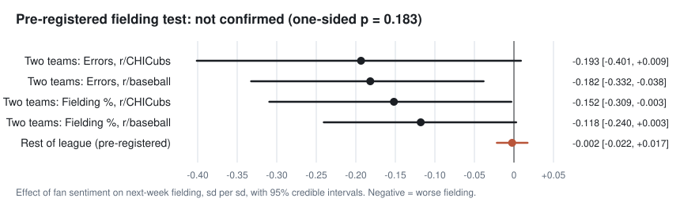
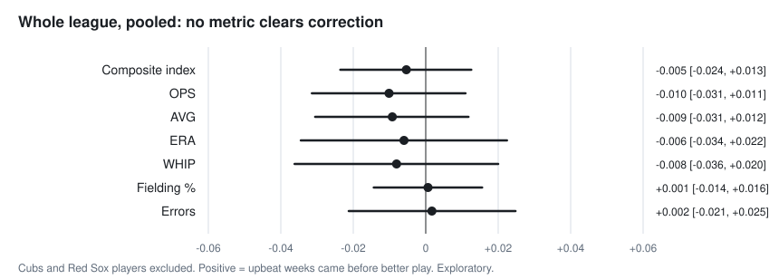
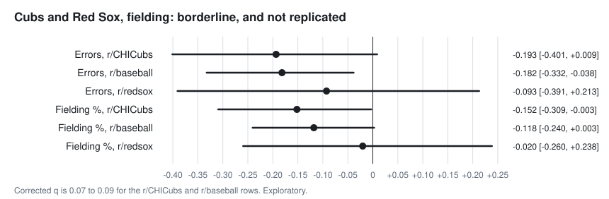

# fansent — are the fans always right?

Personal research CLI correlating fan sentiment (Reddit + news) with MLB player
performance, and comparing fanbases on how "right" they are about their players.

**Question:** does fan sentiment in week *t* predict a player's performance in
week *t+1*, beyond what week *t* performance (and season-to-date form) already predicts?
Fanbases compared: all 30 team subreddits, r/baseball (neutral baseline), and `news` (GDELT
headlines) — each judged only on the tracked players it talks about.

## Result (2026 season)

**No.** Across the 2026 regular season we find no evidence that fan sentiment about a player
predicts his next-week performance beyond what his recent performance already predicts.

- **First pass, two teams.** On Cubs and Red Sox players the analysis turned up one unplanned
  signal: upbeat weeks came before *worse* fielding (errors, fielding %).
- **Pre-registered test, rest of the league.** We wrote down one test of that signal before
  looking at any other team ([`docs/preregistration.md`](docs/preregistration.md)) and ran it
  once on 651 fanbase-player pairs and 11,818 player-weeks. Not confirmed: pooled effect
  -0.002 sd per sd of sentiment, 95% CrI [-0.022, +0.017], one-sided p 0.183.
- **Everything else, exploratory.** No league-wide metric (OPS, AVG, ERA, WHIP, fielding,
  composite, OAA) clears correction, and none of 218 per-fanbase cells has q < 0.10. The
  pooled league fit could detect effects of about 0.03 sd per sd (see [Power](#power)), so the
  null is informative at that size.
- **What is left of the two-team signal.** Under the corrected permutation null it is
  borderline in the Cubs and Red Sox data (q 0.05 to 0.09) and appears nowhere else. We read
  it as unconfirmed.







Effects are in sd of next-week performance per sd of fan sentiment, with 95% credible
intervals. The figures are drawn by `fansent figures` from the committed aggregate snapshot
(`results/published/2026-11-22-final.json`), so they need none of the private data.

Full numbers, the permutation-null bias found along the way, and one correction to an earlier
version of the write-up: [`docs/results-2026-11.md`](docs/results-2026-11.md). Everything here
is one season of observational data; the limits are listed in that note.

**Status (2026-11-22):** the 2026 analysis is finished. The code is kept runnable for a future
season; a new season's confirmatory claim would need its own pre-registration.

## Setup

```sh
make setup          # uv sync
make check          # ruff + pytest
```

Docker alternative: `make docker-build`, then `make docker-run ARGS="rosters"`.

## Pipeline

```sh
uv run fansent rosters --season 2026          # all 30 teams, weekly 40-man -> players.csv, player_teams.csv
uv run fansent stats --season 2026            # weekly stats -> data/stats.csv
# texts.csv (+ sidecars) come from the collectors (see below)
uv run fansent score                          # VADER -> data/sentiment.csv
uv run fansent correlate --perm-b 1000 --workers 8   # -> data/analysis_{fanbases,units,oaa}.csv
```

## Sentiment scoring

`fansent score --scorer vader|lexicon|clf [--model PATH]` writes
`sentiment.csv`; `compound` is the score in [-1, 1] whichever scorer ran, so `correlate`
is unchanged.

- `vader`: raw VADER (default). Misreads baseball slang (nasty, filthy, killing it) and
  sentiment aimed at someone other than the named player.
- `lexicon`: VADER plus a baseball overlay (`src/fansent/classifier/baseball_lexicon.json`,
  edit freely: words, phrases, emoji, VADER-scale valences).
- `clf`: own classifier (`src/fansent/classifier/`). The row's player is masked as
  `__TGT__` and other rostered players as `__OTH__`; features are word 1-2-gram and char
  3-5-gram TF-IDF plus a block of n-grams within +-k tokens of `__TGT__`; model is L2
  multinomial logistic regression with balanced class weights, fit by L-BFGS on our own
  loss/gradient. Score = P(pos) - P(neg).

Optional feature blocks (each off by default, combinable, weights tuned by CV on the
training data only): `--lex` adds baseball-lexicon scores, `--parent` adds the parent
comment's TF-IDF plus an `is_reply` flag (needs a `parent_text` column in the labeled CSV),
and `--emb` adds mean fastText vectors of the comment and the target window. `--emb` needs the
pretrained model once: `uv run fansent clf-fetch-embeddings` (5.8 GB download, 7.2 GB on disk
in `<data-dir>/embeddings/`, gitignored; `--emb-path` points elsewhere). Out-of-vocabulary
words get vectors from their character n-grams, via our own reader of the `.bin` format.
`fansent score` feeds `--parent` models the parent text of `reply_inherited` rows (see
"Where the text data comes from"); explicit rows are non-replies, as in training.

### Relevance filter

A matched surname is often someone else: with a Cubs + Red Sox roster, "Martinez" or
"Turner" in r/baseball usually means a player we do not track (~39% of Sonnet-labeled
r/baseball matches are `na`, ~3% in the team subs). A second from-scratch classifier (same
L2 logistic regression and L-BFGS) predicts whether a matched comment is about the matched
player. Its features keep the name context that sentiment masking hides: match type (full
name, alias, surname only), the words next to the mention, whether the preceding word is
another first name or capitalized word, mention casing, own-team versus other-team terms
(all 30 clubs, `classifier/teams.py`) in the comment and its parent, whether the parent
names the player, and the subreddit (dense flags are duplicated for r/baseball so it learns
its own rules), plus word TF-IDF. Labels: `na` vs pos/neu/neg from the labeled CSVs.

```sh
uv run fansent clf-eval  --task relevance --train a.csv b.csv --test test.csv  # holdout + test report
uv run fansent clf-train --task relevance --train a.csv b.csv                  # -> <data-dir>/models/relevance.npz
uv run fansent score --scorer clf          # uses relevance.npz automatically if present
```

The drop threshold is chosen on out-of-fold CV scores: `--operating-point precision`
(default; lowest threshold with CV precision >= `--min-precision`, 0.8) or `f1`. `fansent score`
drops rows with P(na) >= threshold before scoring, prints kept/dropped counts per subreddit,
and writes `relevance.csv` (`text_id, player_id, p_relevant, kept`) for audits and sensitivity
checks. `sentiment.csv` keeps its schema. `--relevance-model PATH` overrides the model,
`--no-relevance` disables the filter. A stale `relevance.csv` from an earlier run is not removed.

Labeled CSV schema (`text, player, player_id, final_label` or `draft_label`, optional
`aliases` as `;`-separated nicknames; `na` rows are excluded from training and evaluation):

```sh
uv run fansent clf-eval --train a.csv b.csv --test test.csv   # CV-tunes, then VADER vs lexicon vs clf
uv run fansent clf-train --train a.csv b.csv
uv run fansent score --scorer clf
```

`--players` (default `<data-dir>/players.csv`) supplies the roster used for `__OTH__` masking;
`clf-train --out` and `score --model` default to `<data-dir>/models/clf.npz`. Explicit path
arguments are taken as given (relative to the current directory, not `--data-dir`).
All commands read and write one data directory, chosen by `--data-dir DIR` (given before the
subcommand, e.g. `fansent --data-dir ~/fansent-data stats`), else `$FANSENT_DATA_DIR`, else
`./data` relative to the current directory. Note `fansent-collect` defaults differently (an
absolute path next to this checkout), so set `FANSENT_DATA_DIR` in your shell if you run both
tools from arbitrary directories.

## Where the text data comes from

Reddit and news collection lives in a separate, private companion repo
(`fansent-collect`), kept out of this public repo by design. It reads
`data/players.csv` and writes into `data/`:

- `texts.csv` — `text_id, source, subreddit, date, created_utc, player_id, player_name, text`
  (one row per text x mentioned player; `date` is the UTC day; `source` is e.g.
  `reddit_arctic` or `gdelt_headline`; `subreddit` is empty for headlines)
- `reddit_attribution.csv` (optional) — `text_id, player_id, attribution, parent_id`;
  `attribution` is `explicit` or `reply_inherited` (player named in the parent comment)
- `news_headlines.csv` (optional) — `text_id, player_id, url, domain, attribution, seendate`
- `parent_texts.csv` (optional) — `parent_id, text`; the comment each `reply_inherited` row
  replies to (`parent_id` as in `reddit_attribution.csv`). Only `fansent score --scorer clf`
  with a `--parent` model reads it: matching rows get `is_reply=1` and the parent-text block,
  truncated to the first 300 characters (the `parent_text` length of the training samples).
  Without it, those rows are scored as non-replies and a warning gives how many.

A missing sidecar means every mention counts as explicit. `fansent score` turns `texts.csv`
into `sentiment.csv` (VADER compound per text x player).

## Data sources

- **MLB Stats API** (statsapi.mlb.com) — rosters + game logs; free, no key, read-only.
- **Reddit** (via `fansent-collect`) — fan comments; personal, non-commercial research.
- **GDELT DOC 2.0** (via `fansent-collect`) — news per player; free, no key.

## Method (`fansent correlate`)

Per metric (OPS, AVG, ERA, WHIP, FLD_PCT, ERRORS, CS_PCT, and a COMPOSITE index):

1. **Panel.** Fanbase = the subreddit's fanbase for Reddit (`src/fansent/team_subreddits.csv`:
   `fanbase, subreddit, team_id, status`, all 30 teams verified 2026-11-16; Mets = NewYorkMets +
   Mets and Athletics = OaklandAthletics + SacramentoAthletics each pool into one fanbase, the
   A's are low-volume), `news` for `gdelt_headline`. A team fanbase counts only mentions of its
   own team's players (user decision 2026-10-13), judged by week (2026-11-16): the player must
   be on that team's 40-man in the Mon-Sun week of the text date (`player_teams.csv` from
   `fansent rosters`), so traded players leave the old team's fanbase and count for the new one
   from arrival. Without `player_teams.csv` it falls back, with a warning, to the single
   `team_id` in `players.csv`. `r/baseball`, `news`, and any subreddit not in the map are league-wide
   (no filter); rows dropped per fanbase are printed. `--all-teams` (or
   `PanelConfig(fanbase_teams={})`) disables the filter for sensitivity checks. Per (fanbase,
   player, Mon-Sun week): weighted mean VADER compound and mention count. Each row at week *t*
   carries `perf` = metric at *t*, `std` = season-to-date metric through *t*, `sent` at *t*,
   `y_next` = metric at *t+1* (consecutive weeks required) and `weight` = the sample size at
   *t+1*. Raw values are kept with `higher_is_better`; the sign is flipped only when fitting, so
   every effect reads "positive = better performance".
2. **Model.** `fansent.hierarchical`: `y_next = alpha_unit + b1*perf + b2*std + gamma_unit*sent`,
   unit = (fanbase, player), `gamma_unit ~ N(mu_fanbase, tau_fanbase^2)`; Gibbs sampler written
   from scratch. `mu_k` is the fanbase effect, reported in sd of next-week performance per sd of
   sentiment (variables are z-scored globally). `p_pos` = posterior P(mu_k > 0).
3. **Permutation null.** Default `--null freedman-lane`: within each unit, sentiment is
   regressed on the model's controls (week-t perf and season-to-date std; common slopes, unit
   intercepts), the residuals are permuted within unit and added back to the fitted values, so
   fans' reaction to performance is kept and only the part of sentiment that could carry
   information about next week is destroyed. `--null shuffle` is the original null (sentiment
   itself shuffled within unit); it is biased when sentiment reacts to performance (null centered
   off 0). Either way y_next, perf and std are fixed, the model is refit (light,
   `store_units=False`), and the posterior mean of each `mu_k` collected. Two-sided
   `perm_p = (1 + #{|null - c| >= |obs - c|}) / (1 + B)` with `c` = null median;
   `perm_p_less` / `perm_p_greater` compare obs with the null as is. Seeded and independent of
   worker count.

   **Reading the pooled `mu_k` (2026-11-22).** Do not read the pooled `mu_mean` against zero.
   The Freedman-Lane null keeps each unit's mean sentiment and the part of sentiment explained
   by the controls, and the pooled model's `mu_k` absorbs some of both, so the null is centered
   on that share, not on 0. Output column `null_mean` is that center and `mu_minus_null` =
   `mu_mean - null_mean` is what is left for the within-player, beyond-controls part. The offset
   is largest where most of the sentiment variance is between players: league OAA (monthly,
   about 4 points per player) has `null_mean` +0.028, against +0.008 or less for the weekly
   metrics. The p-values already compare `mu` with the null's own distribution and need no
   adjustment. `mu_minus_null` is a reading aid on the pooled scale, not a separate estimator:
   it has no interval of its own, and nothing is decided on it (`confirm` does not use it).
   For a within-player estimate with an interval, use `--estimator mundlak`.

   **Within-player estimator (`--estimator mundlak`, opt-in, exploratory).** The default
   `pooled` model multiplies *raw* sentiment by `gamma_unit` while the unit intercepts are
   shrunk, so `mu_k` mixes the between-unit association (players who are discussed more
   positively on average also do better on average) with the within-player effect, and the
   pooled controls do not remove within-player mean reversion. `mundlak` splits sentiment,
   perf and std into unit mean plus within-unit deviation (plain unweighted unit means),
   applies `gamma_unit` / `mu_k` to the sentiment *deviation*, uses the perf / std deviations
   as controls, and adds the three unit means as extra covariates with common fixed
   coefficients (the Mundlak device). `mu_k` is then the within-player effect, in sd of next-week
   performance per sd of *within-unit* sentiment; this is a different estimand and scale from
   the pooled `mu_k` and the two are not comparable. The extra output column `beta_between` is
   the standardized coefficient on the sentiment unit mean (sd of next-week performance per sd
   of unit-mean sentiment, common to all fanbases of a metric). The model's precision weights
   (next-week PA / IP) are unchanged and are not used in the unit means. The Freedman-Lane null
   carries over unchanged: the sentiment deviation is regressed on the demeaned controls and
   its residuals permuted within unit; unit means never move. `confirm` stays on the registered
   `pooled` estimator, and any future confirmatory use of `mundlak` needs a new pre-registration.
4. **Multiple comparisons**, corrected within separate families (Benjamini-Hochberg `q_bh` and
   Holm `p_holm`, both hand-implemented; `--correction` picks which one the `*` marker in the
   printed table uses, default BH). Families: `metrics` (OPS, AVG, ERA, WHIP, FLD_PCT, ERRORS x
   fanbase); `COMPOSITE` (the headline test, corrected only among its own fanbases); `OAA`
   (secondary). `CS_PCT` is `exploratory`: raw `perm_p` only, `q_bh`/`p_holm` are NA and it is
   excluded from every family. The `family` and `exploratory` columns record this, and the
   printed table is grouped by family.
5. **COMPOSITE.** Per metric, oriented values are z-scored pooled over eligible player-weeks;
   a player-week's composite is the weighted mean of the z-scores available that week
   (hitters: OPS 0.375, AVG 0.375, FLD_PCT 0.125, -ERRORS 0.125; pitchers: ERA 0.5, WHIP 0.5,
   no fielding; configurable in `PanelConfig.composite_weights`). Its season-to-date control is built the same way from
   `std_value`. Role = hitter if the player ever reached 20 PA, else pitcher. A week needs a
   hitting/pitching metric, so fielding alone never forms a composite. The composite has no
   sample-size weight.
6. **OAA check.** Monthly mean sentiment vs next-month Outs Above Average (consecutive months),
   controlling current-month OAA and cumulative season OAA, through the same model and
   permutation, unweighted (the Savant export has no attempts column). A unit needs >= 3
   consecutive-month pairs (month m with OAA and sentiment, month m+1 with OAA); the cumulative
   control is the sum of the independent monthly values up to m. March and April are one bucket
   labeled 2026-04, so that month is longer than the rest. Monthly data gives ~5 points per unit,
   too few for per-unit partial correlations, so the hierarchical pooling is used instead.

**Fit settings and scope flags (2026-11-17).**

- `--chains/--iter/--burn` configure the main fit (defaults 4 x 6000, burn 3000; on real data
  this gave max R-hat 1.015 where 2000 iterations gave 1.084). The permutation fits keep their
  own light settings, `--perm-iter/--perm-burn` (defaults 600/300).
- `--teams TEAM_ID|ABBR ...` keeps only sentiment rows where (player, Monday-week of the text
  date) is in `player_teams.csv` with one of these team ids; abbreviations resolve through
  `teams.csv`. It needs `player_teams.csv`. It applies before and independently of the own-team
  filter.
- `--pool-stats {league,teams}` (default `league`) sets who the COMPOSITE z-scores are pooled
  over. `league`: every player in `stats.csv`, so composite values are comparable across runs.
  `teams`: only the players still present after `--teams/--fanbases/--exclude-fanbases`, so
  "good" means good relative to that group, and composites are not comparable with league runs.
  Only the COMPOSITE changes; single metrics are never pooled.
- `--fanbases NAME ...` (include only) and `--exclude-fanbases NAME ...` (drop), matched
  case-insensitively against fanbase names (`news`, `baseball`, a team fanbase such as
  `Yankees`). Defaults are neutral, so news is included unless dropped:
  `fansent correlate --exclude-fanbases news` for Reddit only.

- `--exclude-teams TEAM_ID|ABBR ...` is the inverse of `--teams`: drops rows where (player,
  Monday-week of the text date) is on one of those teams; player-weeks missing from
  `player_teams.csv` are kept. Needs `player_teams.csv`; composes with `--teams`.
- `--pool-fanbases` fits every included unit as one group with a single `mu` (fanbase column
  `pooled`). Units stay (fanbase, player), so a player discussed in two fanbases (own team sub
  and r/baseball) is two units that share the same outcome series; the pooled interval treats
  them as independent and is therefore somewhat too narrow. The permutation null is unaffected
  (permutation is within each unit).
  Per-unit rows in `analysis_units.csv` keep their real fanbase.
- `--alternative {two-sided,less,greater}` (default two-sided) picks which permutation p feeds
  `q_bh`/`p_holm` and the `*` marker. Every row carries `perm_p` (two-sided), `perm_p_less =
  (1 + #{null <= obs}) / (1 + B)` and `perm_p_greater` (mirror). `less` tests "more positive
  sentiment, worse next outcome" (negative `mu`, in the better-performance orientation).
- Metric `FLD_Z` (name it in `--metrics`; not built otherwise): fielding percentage and negated
  errors are each z-scored pooled over their eligible player-weeks, then averaged weighted by
  the week's chances (both components carry the same chances weight, so in practice an equal
  mean), higher = better. `weight` = week chances. The week-*t* control is FLD_Z itself; the
  season-to-date control z-scores `std_value` (computed from the cumulative `std_` counts, as for
  every metric) per component against its own pooled distribution, as COMPOSITE does, because
  cumulative errors live on a different scale than weekly ones. The z pools are league-wide
  (every player in `stats.csv`). It sits in the `metrics` family.

Thresholds below are unconfirmed assumptions rather than tuned values (composite weights, the
reply weight and the correction families are user decisions of 2026-10-12): weekly minimum sample
OPS/AVG 10 (PA/AB), ERA/WHIP 3 IP, FLD_PCT/ERRORS 3 chances, CS_PCT 2 attempts; >= 3 mentions
per player-week; >= 8 weeks per unit; >= 3 units per (metric, fanbase); `reply_inherited`
mentions weigh the same as explicit ones (`--reply-weight`, user decision 2026-10-12); OAA months need >= 10 mentions
and a unit >= 3 consecutive-month pairs.

Outputs: `analysis_fanbases.csv` (`family, exploratory, metric, fanbase, mu_mean, ci_low, ci_high, p_pos, perm_p,
perm_p_less, perm_p_greater, q_bh, p_holm, n_units, n_obs, rhat_max`), `analysis_units.csv` (per-unit shrunk effects),
`analysis_oaa.csv` / `analysis_oaa_units.csv`. `--method partial` runs the legacy per-pair
partial correlation (OPS/ERA only, `analysis_players.csv`, `analysis_fanbases_partial.csv`) for
comparison; it does not use the model, permutation test or corrections.

## Power

`fansent power` answers "if there were an effect, would this design have found it?", so a null
can be stated as "no effect larger than X". It simulates panels from the hierarchical model's own
structure (per-unit intercepts, perf/std controls, `gamma_unit ~ N(mu, tau^2)`) at the sizes of
the real run (units and obs per unit are read from the COMPOSITE rows of `analysis_fanbases.csv`;
defaults if absent), refits each with the same Gibbs sampler (light settings: 2 chains, 600
iterations), and counts a detection when the 95% CrI of `mu` excludes 0. Seeded, independent of
`--workers`. Noise (`--sigma 1.0`) and between-player spread (`--tau 0.1`) are assumptions, not
read from a run; they reproduce the real run's CrI widths (simulated 0.26 for a team sub, 0.17
for r/baseball; real Cubs 0.26, r/baseball 0.19).

The CrI rule is a proxy. The shipped test is a permutation p-value with BH correction within
family, so CrI power is an upper bound on the shipped test's power and the MDE a lower bound.
Checked at team-sub size (`--perm-b 99`, 40 replicates per point, uncorrected permutation
p < 0.05): power 0.07 / 0.38 / 0.90 / 1.00 at mu = 0 / 0.1 / 0.2 / 0.3, the same as the CrI
within Monte-Carlo noise, so the loss comes from the multiplicity correction, not the permutation.

Power at R = 150 datasets per point (mu in sd of next-week performance per sd of sentiment).
`team` = 23 units x 15.9 weeks; `r/baseball` = 47 x 16.2; `league` = 30 fanbases x 25 units
(per-fanbase power, 4500 tests per point); `pooled` = those 750 units fit as one fanbase, i.e.
the average effect across 30 teams, assuming they share one mu.

| mu | team sub | r/baseball | league, per fanbase |
|---|---|---|---|
| 0 | 0.05 | 0.07 | 0.03 |
| 0.05 | 0.10 | 0.25 | 0.11 |
| 0.10 | 0.33 | 0.75 | 0.37 |
| 0.15 | 0.63 | 0.98 | 0.70 |
| 0.20 | 0.79 | 1.00 | 0.92 |
| 0.30 | 1.00 | 1.00 | 1.00 |

| pooled mu | 0 | 0.01 | 0.02 | 0.03 | 0.05 |
|---|---|---|---|---|---|
| power | 0.07 | 0.17 | 0.47 | 0.88 | 1.00 |

Minimum detectable effect at 80% power: team sub 0.20, r/baseball 0.11, league per fanbase
0.17, pooled league-wide 0.028. With `--tau 0.2` the team-sub and r/baseball MDEs rise to 0.24
and 0.13. Pitching-metric subsets (8-13 units, ~13 obs each; `--scenarios pitching`) are weaker
still. Rough reading: a single team's null rules out effects above about 0.2 sd per sd, not
smaller ones; only the pooled league-wide estimate can exclude effects of a few hundredths.
Rows near mu = 0 give the false-positive rate, nominal 0.05 (observed 0.03 to 0.07). Outputs:
`power_curves.csv`, `power_mde.csv`. Simulated runtime: 264 s for the full default set at
R = 150 on 6 workers (heavily loaded machine).

## Confirmatory test

The fielding result from the Cubs + Red Sox run was unplanned, so it is re-tested on the rest
of the league under a specification written before any league data was analyzed:
[`docs/preregistration.md`](docs/preregistration.md). `fansent confirm` runs exactly that
specification and nothing else (no flags change it; `--workers` and `--seed` only affect
speed and the random stream):

```bash
uv run fansent --data-dir <league data dir> confirm --workers 8
```

It runs `FLD_Z` only, drops every player-week on the Red Sox (111) or Cubs (112) per
`player_teams.csv`, excludes `news`, applies the own-team rule, pools all fanbase units into one
group, and uses 4 chains x 6,000 iterations (burn 3,000), B = 1,000 within-unit shuffle permutations
(the registered null; `correlate`'s default is now Freedman-Lane) and the one-sided permutation
p (`perm_p_less`). **CONFIRMED** iff the pooled `mu` is negative and
`perm_p_less < 0.05`; otherwise **NOT CONFIRMED**. The pooled `mu`, its 95% credible interval and
the p-values are printed and written to `confirm_result.json` either way. If max R-hat is not
below 1.05 the fit has not converged and the verdict is `INVALID (R-hat gate failed)`, flagged
in the output and the JSON, instead of either outcome. Pooling treats a player who appears in
two fanbases as two units (see `--pool-fanbases` above), so the interval is somewhat narrow;
the registered decision uses the permutation p. `confirm` also prints and writes, labelled
supplementary (post-hoc null fix, not part of the registered decision), the Freedman-Lane
one-sided p and the null-centered two-sided p. Anything beyond this single test is exploratory.

## Results snapshot and figures

Published results leave `data/` only as an aggregate snapshot, and the README figures are drawn
from that snapshot alone:

```sh
uv run fansent snapshot --run-id <id> --section league=<run-dir> --section demo=<run-dir> \
    --section league_fanbases=<run-dir> --confirm data/league/confirm_result.json --status final
uv run fansent figures                       # newest snapshot -> docs/img/*.svg (README figures)
uv run fansent site                          # optional local page: site/index.html (+ data.json)
```

The snapshot holds only per-(metric, fanbase) summary numbers from `analysis_fanbases.csv`;
`fansent.site.validate_snapshot` rejects unknown keys, any string outside the metric/family
vocabulary or a short identifier pattern, and non-finite numbers, so free text cannot be
published. Per-player files (`analysis_units.csv`) are never read. A schema-2 snapshot
(`--section`, 2026-11-22) has one block of rows per scope (`league`, `demo`, and the data-only
`league_fanbases`; their headings and descriptions are fixed text in `site.py`), the null used,
and, with `--confirm`, nine summary numbers of the pre-registered test picked out of
`confirm_result.json`. `fansent snapshot <run-dir>` without `--section` still writes the older
one-run format.

The GitHub Pages site was retired on 2026-11-22: the static results are the figures in this
README, and `fansent site` remains only as a local preview of a snapshot.

## Notes & caveats

- Name matching: full name always; bare last name only when unique among
  tracked players (≥4 chars). Common-word last names can still false-positive.
- Weekly windows are Mon–Sun (regular season only).
- Weekly OPS/ERA is extremely noisy — expect small effects; the pooled fanbase effects
  `mu_k` are the robust readout, not any single unit's `gamma`.

## Data schema (model contract)

`data/stats.csv` — tidy long, one row per player-week-metric; rows exist only for weeks
where the metric's weekly denominator is positive.

| column | meaning |
|---|---|
| `player_id, full_name, team, season` | identity (`player_id` = MLBAM id) |
| `week_start` | Monday (ISO date) of the Mon-Sun week |
| `group` | `hitting`, `pitching` or `fielding` |
| `metric` | `OPS`, `AVG` (hitting); `ERA`, `WHIP` (pitching); `FLD_PCT`, `ERRORS`, `CS_PCT` (fielding) |
| `value` | metric for that week alone |
| `std_value` | season-to-date metric through the END of that week (weeks <= t only), recomputed from summed counts |
| `weight` | weekly sample size: PA (OPS), AB (AVG), IP (ERA, WHIP), chances (FLD_PCT, ERRORS), SB+CS attempts (CS_PCT) |
| `std_weight` | same, season-to-date |
| `higher_is_better` | False for ERA, WHIP, ERRORS |

Fielding aggregates every position a player played that week (the log has one split per
game per position): counts are summed across positions and `games` counts distinct games.
`CS_PCT` = caught stealing / (SB + CS) allowed, so only catchers get rows. `ERRORS` is a
weekly/cumulative count, not a rate.

`data/stats_counts.csv` — wide companion: `player_id, full_name, team, season, week_start,
group`, then raw weekly counts `games, pa, ab, h, bb, hbp, sf, tb, outs, er, chances,
putouts, assists, errors, sb, cs` and the same prefixed `std_`. Columns not used by a
group are 0. For pitchers `h`/`bb` are hits/walks allowed and `outs` = innings x 3.

`data/oaa_monthly.csv` — from `uv run fansent oaa PATH` (reads a Baseball Savant Outs Above
Average CSV export with monthly splits; the download itself lives in the private
collector): `player_id, full_name, month (first of month), oaa, attempts,
fielding_runs_prevented`. Rows for several positions in a month are summed. `attempts` is empty
for real Savant exports (no such column) and is not used.

## License

Apache-2.0 — see [LICENSE](LICENSE).
